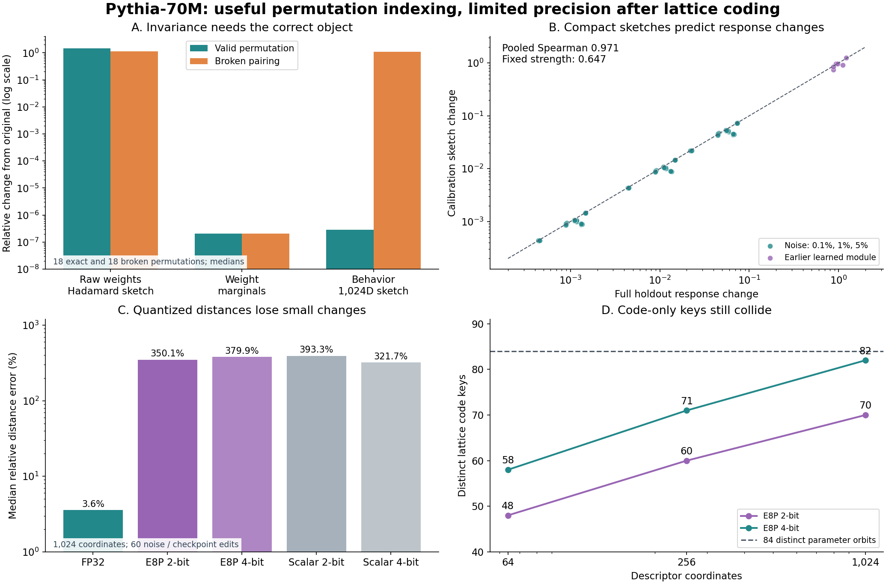

# Pythia-70M permutation and function indexing

Exploratory inference-only experiment, 18 October 2026 America/Denver. Run `pythia-permutation-index-20261019-v1`.

## Finding

Pythia-70M is sufficient for a useful first test. Exact MLP permutation-orbit IDs and compact full-precision behavioral sketches work in this controlled setting. QuIP#'s E8P geometry is useful for compressing the descriptors, but its discrete codes and quantized distances lose small behavioral differences. These findings support continued work on the real model; they do not establish semantic function categories or scaling.

## What ran

- EleutherAI/pythia-70m: 70,426,624 parameters; final step143000 and step64000 from the same training trajectory, pinned and hashed.
- All six MLP sublayers, each composed with its own input LayerNorm, in a fixed residual-stream coordinate system. Whole-head permutations were checked separately in the complete language model.
- 102 atlas entries representing 84 distinct parameter orbits: six originals, 18 coherent permutations, 18 broken pairings, 54 Gaussian edits, and six older-checkpoint module transplants.
- Every atlas entry received another independent coherent permutation as a retrieval query. Three intervention seeds: 73, 191, 307. These are not three pretrained models. The 54 noise rows reuse 18 directions at three strengths.
- 12 calibration and 12 holdout passages, 601 and 608 input tokens respectively. These are original short diagnostics, not a standardized quality benchmark.
- Two common probe banks, each 128 residual states sampled across six layers. Heldout functional distances use the separate bank; whole-model checks use intact heldout documents.
- 32 primary whole-model evaluations, including baseline, duplicate, exact transformations, and altered modules. No optimizer steps or new training.

## Exact equivalence and the crucial negative control

All 102 permuted queries retained their exact orbit hashes; all 18 coherent permutations matched the original layer's orbit. All 78 genuinely changed entries had different orbit IDs. The hash sorts complete incoming-weight, hidden-bias, outgoing-weight tuples, preserving neuron pairing. It includes the fixed output bias and LayerNorm parameters. It is an exact parameter-orbit fingerprint modulo SHA256 collisions, not a universal function identifier.

The median raw-weight Hadamard change under a valid permutation was **1.443 relative RMS**, although the actual heldout MLP response changed by only **2.75e-7**. Raw-weight nearest-neighbor retrieval recognized only **2/102** permuted queries among the 84 orbits. Behavioral sketches recognized **102/102**, even at 64 coordinates. This tests retrieval of a stored function under exact relabeling, not discovery of an unseen equivalent function.

Permuting only the incoming neuron rows retains the separate matrices' value distributions and norm multisets while breaking their correspondence. Our marginal descriptor changed by at most **2.48e-7**, but the actual MLP responses changed by **0.676–1.370 relative RMS**. Full-model KL increased by **0.871–10.301 nats** in these six single-layer controls. A permutation-invariant summary can therefore be almost completely blind to a function-changing edit. Correctly retaining connected-matrix correspondence is essential.

## Predicting heldout behavioral changes

The uncompressed 128-by-512 response bank is 262,144 bytes per module in FP32. A 1,024-coordinate sketch is 4,096 bytes, a 64-fold descriptor reduction. These are descriptor sizes, not model compression or inference memory savings.

| Coordinates | FP32 bytes | Spearman with holdout | Median relative distance error |
| --- | --- | --- | --- |
| 64 | 256 | 0.978 | 10.77% |
| 256 | 1,024 | 0.965 | 7.22% |
| 1024 | 4,096 | 0.971 | 3.59% |

The table uses 60 noise/checkpoint edits. Full calibration responses give Spearman **0.981** and median error **4.70%**, reflecting the calibration/holdout probe mismatch. The sketch's slightly lower median error is not evidence that compression improves the underlying function measurement.

The high pooled correlation partly separates the three intervention magnitudes. At each fixed noise strength, across 18 layer/seed cases, Spearman falls to **0.647** for the 1,024D behavioral sketch, compared with **0.148** for raw-weight sketch distance and **0.769** for the full calibration response. This is a promising but substantially weaker signal about direction-sensitive behavior. No semantic labels such as copying or arithmetic were learned or validated.

## What E8P contributes, and what it loses

The CPU implementation uses the paper's 65,536 eight-dimensional E8P codewords, checked against exhaustive nearest-neighbor search and code roundtrips. It acts on the descriptor after Hadamard sketching. It does not quantize model weights, use BlockLDLQ/Hessian feedback, or execute the complete QuIP# pipeline. Two-pass residual E8P supplies the 4-bit variant. Scalar controls use the same payload bits; E8P-4 carries one additional 4-byte scale.

| 1,024D descriptor | Bytes incl. scales | Exact query retrieval | Distinct code-only keys / 84 | Median fine-distance error |
| --- | --- | --- | --- | --- |
| fp32 | 4096 | 100% | n/a | 3.6% |
| e8p2 | 260 | 100% | 70 | 350.1% |
| e8p4 | 520 | 100% | 82 | 379.9% |
| scalar2 | 260 | 100% | n/a | 393.3% |
| scalar4 | 516 | 100% | n/a | 321.7% |

All methods retrieved the exact queries, but the FP32 scale metadata was part of the reconstructed vector. E8P-2's lattice keys alone produced only **70 distinct keys for 84 distinct orbits**; E8P-4 produced 82. A lookup by codeword alone has collisions. A 100% retrieval score with scale metadata is not a collision-free semantic hash.

E8P reduced median absolute vector reconstruction error: **30.0% versus 34.2%** for the 2-bit scalar control and **9.44% versus 10.32%** at 4 bits. Nevertheless, distances between nearby vectors were badly distorted because small changes can stay within one quantization cell or cross a cell boundary. The 1,024D E8P-2 median relative fine-distance error was **350%**, versus **3.59%** without quantization. E8P-4 was **380%**. These relative errors are large partly because the true changes are small; they do not mean the reconstructed descriptors themselves have 350% error.

At 1,024D, E8P-2 passes the preregistered relative-to-scalar gate by about 11%, but that gate did not constrain absolute distance error. This is an explicitly recognized weakness of the gate, not a reason to promote E8P for fine update measurements. E8P-4 fails the analogous scalar-4 comparison. Use full-precision sketches for continuous comparisons; optionally use lattice keys for coarse candidate grouping followed by full-precision reranking.

## Whole-model checks and numerical diagnosis

All six all-layer coherent MLP/head permutation runs retained all **96 checked next-token argmax predictions**. Four exceeded the original FP32 relative-logprob tolerance of 1e-5; the largest error was **1.09845e-5**. The primary terminal status remains `COMPLETED_WITH_FAILED_CHECKS`. It is not silently relabeled as a clean pass.

A separately frozen follow-up repeated the first failed seed for both MLP and whole-head permutations in FP32 and FP64, with one and three threads. The FP32 discrepancies reproduced. FP64 relative logprob errors were at most **3.85e-15**, below the follow-up threshold of 1e-10; raw logit relative errors were at most 2.43e-16. This supports rounding amplification as the explanation. The diagnostic confirms the intended mathematical symmetry for the tested seed; it does not change the original FP32 threshold or substitute three independent model replications.

| Block | Max local exact response error | Broken MLP KL (nats) | Step64000 module transplant KL |
| --- | --- | --- | --- |
| 0 | 2.31e-07 | 4.376 | 0.337 |
| 1 | 2.98e-07 | 1.033 | 0.341 |
| 2 | 2.79e-07 | 1.489 | 0.664 |
| 3 | 3.38e-07 | 0.871 | 0.338 |
| 4 | 2.78e-07 | 2.654 | 0.557 |
| 5 | 1.50e-07 | 10.301 | 18.651 |

Earlier modules were transplanted one at a time with their LayerNorm into the final checkpoint. Large errors, particularly at the last block, can reflect incompatibility with the final model's other parameters. They are not evidence that the intact step64000 model performs that badly. Baseline diagnostic next-token NLL was 4.5973 nats over 596 targets. No quality-improvement claim is made.

## Cost, reproducibility, and decision

The primary suite took **48.5 seconds** with three CPU threads; the explicit numerical follow-up took **16.1 seconds**. Downloads, implementation, rendering, and publication are excluded. Median per-module times were **8.90 ms** for the orbit hash, **3.75 ms** for one 128-input MLP response bank, and **1.43 ms** for the sketch. Probe extraction and full-model execution are additional. These are diagnostic costs, not training or decoding speedups.

Code, frozen protocol, exact tokens, intervention seeds, raw rows, descriptors, codewords, hashes, numerical failure receipt, and follow-up are retained. Public checkpoint weights are downloadable by immutable commit and SHA256 and are excluded from Git. The only correction to primary executed source was a license attribution in a docstring; its original byte-exact source and correction receipt are preserved.

**Decision:** continue on Pythia-70M with an exact orbit ID plus a continuous behavioral descriptor. Treat E8P as optional coarse storage, not the identity or fine-distance metric. Next, test matched-norm edits aimed at distinct behaviors and probe families; then replicate on another pretrained seed and model size. The present results establish controlled feasibility, not semantic categorization, continual-learning gains, or scaling.

Reproduction: [source and commands](../research-scratch/pythia-permutation-index-20261019-v1/README.md). Measurements: [result directory](../results/pythia-permutation-index-20261019-v1/).

Primary references: [QuIP#](https://proceedings.mlr.press/v235/tseng24a.html), [official E8P implementation](https://github.com/Cornell-RelaxML/quip-sharp/blob/main/lib/codebook/latticee8_padded12.py), [Pythia](https://github.com/EleutherAI/pythia), [Git Re-Basin](https://arxiv.org/abs/2209.04836).
