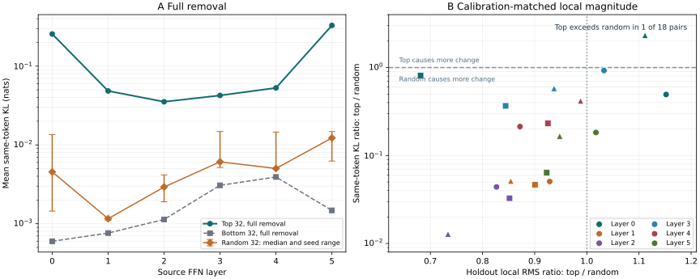

# Local magnitude does not reliably predict downstream importance

**Native intervention evidence · pinn-mgl 0.3.0 · 19 October 2026**

The decompiler now connects source-linked FFN contributions to measured changes after the actual remaining model computation. The first Pythia-70M study also exposes a limitation of the previous ranking: full removal of large local contributions produces larger output changes, but after matching aggregate local effects on calibration data, those groups exceed random groups in only **1 of 18 same-token KL comparisons**.

[Open the evidence inspector](../analyses/downstream-effects-v1/index.html) · [Implementation and conventions](../development/downstream-effects.md) · [Complete measurements](https://github.com/JRowe47/Permutation-Invariant-Neural-Normalization/tree/main/results/downstream-effects-v1) · [Reproduction](https://github.com/JRowe47/Permutation-Invariant-Neural-Normalization/tree/main/experiments/downstream-effects-v1)

## The question tested

The previous contextual pass selected top-32 and bottom-32 FFN contributions using projected local response RMS on a calibration input bank. Its holdout measurements showed that removing the top group changed the isolated FFN output more. That result did not determine how subsequent normalization, attention, nonlinear FFNs, residual additions and the final readout would transform the disturbance.

This experiment edits selected gate activations at one token in one FFN and observes the native model through every block boundary, final normalization and the full 50,304-entry vocabulary readout. It measures total effects of those edits, not semantic meanings or mediation by particular paths.

## Full removal and calibration-matched controls

The following values are mean same-token KL(reference || edited), in nats. The original top-32 group exceeds each of the three full-removal random groups in every layer. The random column shows the median across seeds 73, 191 and 307.

| Layer | Top 32, full removal | Bottom 32, full removal | Random 32, median | Matched top exceeds random |
| --- | --- | --- | --- | --- |
| 0 | 0.255939 | 0.000599 | 0.004551 | 1 / 3 |
| 1 | 0.048414 | 0.000761 | 0.001158 | 0 / 3 |
| 2 | 0.035311 | 0.001133 | 0.002922 | 0 / 3 |
| 3 | 0.042503 | 0.003070 | 0.006105 | 0 / 3 |
| 4 | 0.052926 | 0.003920 | 0.005022 | 0 / 3 |
| 5 | 0.328782 | 0.001477 | 0.012261 | 0 / 3 |

In panel A, the random range is the minimum and maximum across three fixed seeds, not a confidence interval. Panel B shows all 18 paired comparisons after calibration matching. Colors identify layers; circles, squares and triangles identify seeds 73, 191 and 307. Each point uses means over 12 holdout passages, with two distinct intervention sites averaged within each passage.

For each top/random pair, calibration gains reduce the larger local effect to the smaller calibration RMS. Gains are at most one, and no holdout outcome is used to fit them. In this run every top group required attenuation and every random group retained gain one. Only the layer-0 comparison with random seed 307 then had larger mean same-token KL for the top group.

Matching is imperfect on holdout: actual top/random local RMS ratios span **0.681 to 1.152**. The experiment matches aggregate calibration magnitude, not every input or exact holdout magnitude. It also compares different intervention strengths through a nonlinear model. The result therefore does not isolate direction as the sole cause. It does show that the full-removal ranking advantage is not robust to this control, and that a local magnitude score alone is insufficient evidence for a general downstream-importance coordinate.

## What propagated, and what did not

For the unattenuated top groups:

| Source layer | Same-token KL | Later-token KL | Same-token signed NLL change |
| --- | --- | --- | --- |
| 0 | 0.255939 | 0.0040571 | +0.291859 |
| 1 | 0.048414 | 0.0009669 | -0.084441 |
| 2 | 0.035311 | 0.0014858 | +0.174380 |
| 3 | 0.042503 | 0.0002755 | +0.174963 |
| 4 | 0.052926 | 0.0000472 | +0.047501 |
| 5 | 0.328782 | 0.0000000 | +0.148660 |

The edited position and the position eight tokens later are observed, with the later index bounded by the last position that has a next-token target. Tokens remain teacher-forced to the original passage. These are effects on the same fixed sequence, not generated continuations.

Final-layer FFN edits leave the later token exactly unchanged: a pointwise edit cannot reach another position when no later attention layer remains. Earlier-layer edits can propagate through later attention. Boundary records measure that total propagation without identifying which heads or paths mediate it.

KL measures distribution change, not damage. Signed next-token NLL can improve or worsen after intervention; the negative layer-1 value above is retained. No task benchmark or general performance benefit is inferred from these diagnostic passages.

## Protocol and fidelity

The checkpoint is EleutherAI/pythia-70m at revision de3e4e2d6cbb3b1a51f90fe153ea51fcd8c7c852, with exact file hashes recorded. Twelve calibration passages and twelve disjoint holdout passages are reused from the earlier contextual experiment, two positions per passage. This is a reused diagnostic holdout, not new blinded data. Group selectors, gains and the protocol are saved before holdout interventions.

Each of six layers has eight conditions: top32, bottom32, three random32 groups and three attenuated top comparisons. Each condition has 24 single-site trials, totaling **1,152 edited forwards**. The intervention multiplies selected post-GELU activations by one minus the gain before the native outgoing projection; weights and all other source positions remain unchanged.

- Every trial preserves all upstream blocks, every causal-prefix position, and nonedited positions in the source block exactly.
- Every local FFN delta matches its selected additive write within the declared FP32 bound. The largest error is 0.0579 of that bound.
- Six zero-gain shams, one per layer, have exactly zero block and readout change.
- Six example readouts in the first and last layers retain their full vocabulary logits. An independent PyTorch FP64 metric check agrees with NumPy, with maximum absolute KL discrepancy 6.86e-15.
- All 51 tests pass, with no skips. These include native tiny-model checks, metric invariances, causal controls, hook cleanup, immutable source tensors, budgets and profile validation.

An early exploratory run projected baseline and edited readouts in different batch sizes. A zero-gain diagnostic exposed FP32 matrix-multiplication rounding differences. That run was stopped and excluded. The retained run uses the same fixed [1,1,hidden] readout shape for every position and passes all exact sham controls.

## What this adds to the analysis language

The narrow pinn.downstream-intervention/1 profile records the checkpoint identity, contribution selectors, calibration provenance, activation frame, attenuation convention, actual native bridges, observation frames, distribution metrics, validation controls and costs. It uses the existing MGL analysis envelope and has no human-syntax parser or universal execution runtime.

The native adapter currently supports evaluation-mode GPT-NeoX with parallel residual blocks. It rejects other bridge conventions. The core static/contextual analysis and saved-evidence verifier remain NumPy-based; PyTorch and Transformers are optional dependencies for native experiments.

This gives the decompiler an evidence-bearing link from a local candidate to downstream behavior. It does not establish a feature identity, semantic label, complete circuit, invariant model-space origin, cross-model correspondence or learning/update dynamics. The evidence package deliberately makes no such claims.

## Cost and reproducibility

The main run used **1,170 native backbone forwards**: twelve baselines, six shams and 1,152 edits, under a 1,200-forward cap. It made 2,364 single-position full-vocabulary projections. Six small calibration-region evaluations are counted separately. The raw-logit audit added seven backbone forwards and seven projections. No training updates occurred.

Native execution plus measurement took **78.79 seconds** in the recorded CPU environment: Python 3.12.14, NumPy 2.3.5, PyTorch 2.8.0+cpu and Transformers 4.57.1, with one Torch and one OpenBLAS thread. This excludes checkpoint loading, hashing, calibration fits, audit execution, serialization and report generation. Physical I/O, FLOPs and peak working memory were not measured; this is not a scaling benchmark.

With NumPy installed, the saved verifier checks source hashes, all trial controls, frozen selections, aggregate and passage-level measurements, matching receipts, and selected raw vocabulary logits without loading the model:

~~~bash
python experiments/downstream-effects-v1/verify_saved.py
~~~

[Protocol](https://github.com/JRowe47/Permutation-Invariant-Neural-Normalization/blob/main/results/downstream-effects-v1/PROTOCOL.json) · [Source hashes](https://github.com/JRowe47/Permutation-Invariant-Neural-Normalization/blob/main/results/downstream-effects-v1/SOURCE_MANIFEST.json) · [Raw-logit audit](https://github.com/JRowe47/Permutation-Invariant-Neural-Normalization/blob/main/results/downstream-effects-v1/READOUT_AUDIT.json) · [Tests](https://github.com/JRowe47/Permutation-Invariant-Neural-Normalization/blob/main/results/downstream-effects-v1/TESTS.json)

Historical source-hash verifiers belong to their recorded implementation commits. Previous static and contextual measurement files remain unchanged.

## Next development target

Represent output-sensitive directions and their dependence on context, then test whether they predict held-out intervention effects at lower cost than exhaustive native edits. Candidate grouping should preserve the distinction between local magnitude, total downstream sensitivity, and a behavior-specific causal role. A fresh evaluation set and intervention-strength controls are needed before treating that representation as a reusable functional coordinate.
