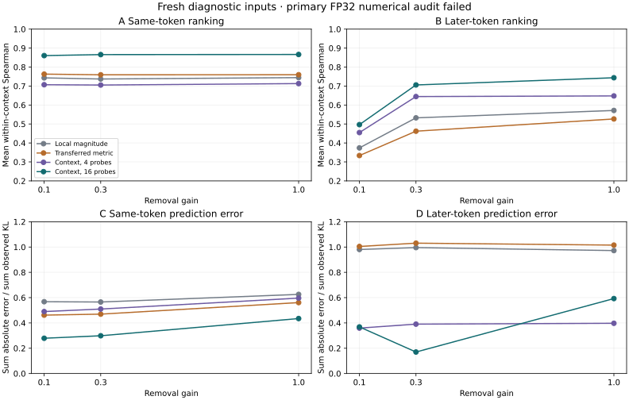

# Context-sensitive sketches improve rankings, with a numerical caveat

**Three downstream-prediction experiments · 19 October 2026**

A 16-probe derivative sketch predicts the ordering of local edits better than a calibrated magnitude score on this new diagnostic set. At 10% removal, mean same-token rank correlation increases from **0.743 to 0.860**. A frozen calibration metric transfers some information, while current-context derivatives predict signed next-token loss much better than an averaged calibration gradient.

**The primary FP32 numerical audit failed.** All native intervention controls passed, but 16 of 24 derivative consistency observations exceeded the preset bounds. The overall run remains marked failed. A separate, small reference calculation using FP64 attention softmax passes the unchanged bounds. This report preserves both the measured prediction results and that limit on their numerical validation.

[Coordinate conventions](../development/downstream-surrogates.md) · [Code and reproduction](https://github.com/JRowe47/Permutation-Invariant-Neural-Normalization/tree/main/experiments/downstream-surrogates-v1) · [Complete evidence](https://github.com/JRowe47/Permutation-Invariant-Neural-Normalization/tree/main/results/downstream-surrogates-v1) · [Previous native intervention study](downstream-effects-v1.md)

## What was frozen before measuring outcomes

Twelve fresh calibration passages and twelve fresh evaluation passages were authored before observing these outcomes. They are disjoint from all earlier project probes. They remain a small diagnostic set, not a representative benchmark or an externally blinded evaluation. The pinned tokenizer reproduces the old sequences, including their explicit leading token 0.

Each passage has one edited token at its midpoint and two observed outputs: that position and a position eight tokens later. Inputs remain teacher-forced. Each of six FFNs has eight fixed 32-unit groups: the previous calibration top and bottom groups plus six seeded random groups. Calibration uses gain 0.1; evaluation uses 0.1, 0.3 and 1.0. The study contains **576 calibration edits and 1,728 evaluation edits**.

The derivative rows are anchored to a source FFN write frame, the exact input, and a selected output distribution. Sixteen fixed random vocabulary probes approximate a local Fisher metric; a four-probe prefix tests the compression cost. A signed NLL gradient supplies a separate first-order prediction. Each prediction receipt is written before its corresponding edited runs.

The magnitude control is fitted only on calibration outcomes. The transferred metric retains the second moment of all calibration derivative rows. Context-specific predictors compute derivatives on each evaluation baseline, with their full cost charged; they are not predictors that avoid model execution altogether.

## Experiment 1: conditional prediction and context transfer

At gain 0.1:

| Predictor | Same-token rank | Same-token median factor error | Later-token rank | Later-token median factor error |
| --- | --- | --- | --- | --- |
| Local magnitude | 0.743 | 4.94× | 0.374 | 12.99× |
| Transferred metric | 0.763 | 1.49× | 0.334 | 3.95× |
| Context, 4 probes | 0.707 | 1.69× | 0.455 | 5.85× |
| Context, 16 probes | 0.860 | 1.26× | 0.497 | 3.66× |

Rank is Spearman correlation across the eight groups within each passage and source layer. Same-token results have 72 valid rankings. Later-token results have 57 of 60 possible rankings at this gain; constant observed rankings remain undefined. The final-layer later-token effects are structurally zero and excluded from both ranking and error summaries.

Median factor error is the larger of predicted/observed KL and its reciprocal, restricted to positive predictions and observed KL above 1e-10. Lower is better, and one is exact. These restrictions retain all 576 same-token cases and 432 of 480 later-token cases at gain 0.1; this metric does not summarize the excluded tiny effects.

The mean passage-level paired rank improvement of the sixteen-probe predictor over magnitude is **0.117**, with a 95% percentile bootstrap interval **[0.045, 0.190]**. Whole passages are resampled, preserving dependence among layers and groups. This describes variability in the twelve authored evaluation passages, not a population-level performance guarantee.

The frozen metric is substantially better calibrated than a scalar magnitude score at the edited position, but loses much of the later-token ranking information. Four probes are cheaper and less reliable: their same-token ranking is below the magnitude control in this run. The sixteen-probe result supports retaining directions and context, subject to the numerical caveat above.

## Experiment 2: intervention strength and signed effects

For the context-specific sixteen-probe predictor:

| Gain | Same-token rank | Same-token relative L1 error | Later-token rank | Later-token relative L1 error |
| --- | --- | --- | --- | --- |
| 0.1 | 0.860 | 0.279 | 0.497 | 0.368 |
| 0.3 | 0.866 | 0.299 | 0.706 | 0.170 |
| 1 | 0.866 | 0.435 | 0.744 | 0.593 |

Relative L1 error is the sum of absolute prediction errors divided by the sum of observed KL, so large effects contribute more. Ranking can remain good even as numerical effect-size estimates worsen. At the edited token, this error grows from about 0.28 at 10% removal to 0.43 at full removal. At later tokens the pattern is not monotonic: small effects and FP32 resolution complicate the lowest-gain comparison. The numerical diagnostic below does not independently establish the cause of every prediction error.

At 10% removal, the current-context NLL gradient predicts the sign correctly in **97.3% of 566 eligible same-token cases**, with relative L1 error 0.070. The transferred mean gradient has sign accuracy **50.4%** and relative L1 error 1.022. Eligibility requires observed absolute NLL change above 1e-4. At full removal the current-context gradient's same-token relative L1 error rises to 0.279.

This difference matters for a functional coordinate: KL describes distribution change, while signed NLL describes whether a particular observed next token becomes more or less likely. Neither is a semantic feature label, and an intervention need not damage a prediction.

## Experiment 3: numerical consistency and cost

Every gradient-enabled FP32 baseline matches ordinary inference exactly. All **2,304 local/causal controls** and **six exact zero-gain controls** pass. Source edits preserve upstream blocks, earlier tokens and other source positions, and reconstruct the intended local write within the declared bound.

The stricter derivative audit compares projected reverse-mode gradients with full directional logit derivatives. It fails 16 of 24 observations, while retaining their raw errors and unchanged tolerances. Tiny-model consistency tests pass, illustrating why those tests alone did not settle behavior on the real checkpoint.

A post-outcome diagnostic fixes the first evaluation passage and the original FP32 top-group local directions in layers 0, 4 and 5. It compares three numerical variants:

| Numerical variant | Largest projected-derivative L2 discrepancy | Observations passing the original bounds |
| --- | --- | --- |
| Native FP32 | 0.00201 | 3 / 6 |
| FP64 model, native FP32 attention softmax | 0.00206 | 3 / 6 |
| FP64 model and FP64 attention softmax | 1.51e-07 | 6 / 6 |

The model's native eager attention explicitly computes softmax in FP32 even when the surrounding model is converted to FP64. The final diagnostic changes only that softmax dtype after the model conversion. This reduces the discrepancy dramatically on the tested subset and supports a precision-based explanation. It changes the numerical computation; it does not retroactively pass the native FP32 audit, reproduce the entire study at higher precision, or establish all other contexts are stable. The original RUN.json flag remains false.

On the twelve evaluation passages, building both output sketches and NLL gradients, then scoring the groups, took **18.65 seconds**. The **1,728 reference edited forwards** took **108.55 seconds**, excluding another 4.94 seconds of metric/control calculations. This is about **5.8×** less time for the shared derivative bundle than that many individual edited forwards. It is not a per-edit speedup: one derivative bundle costs more than one native edit and is amortized across the 144 edits per passage in this experiment.

The timed first-four Fisher VJP subsets took 4.13 seconds across evaluation, versus 16.69 seconds for all sixteen; these are portions of the same run, not standalone end-to-end benchmarks. Calibration computations for the transfer and magnitude controls cost another 55.96 seconds including their native outcomes and measurements. Context-specific derivatives themselves do not require fitting on calibration outcomes.

The primary study used **2,370 backbone forwards**, including 24 gradient-bearing forwards with 816 ordinary VJP calls and twelve directional audits with 24 internal reverse traversals. The structured precision diagnostic added twelve forwards and 102 VJP calls. Preliminary precision pilots added sixteen forwards and 102 VJP calls. The complete investigation used **2,398 Pythia backbone forwards**; all audit traversals and forward-AD pilots are separately recorded. Unit tests use tiny models and are separate. There were no training updates.

The primary run took 192.81 seconds before its final receipt, using cached Pythia-70M weights, Python 3.12.14, NumPy 2.3.5, PyTorch 2.8.0+cpu and Transformers 4.57.1 with one Torch and one OpenBLAS thread. Peak RAM, native FLOPs and physical I/O were not measured. These costs do not establish scaling to larger architectures.

## What the language gains

The retained signed coordinates are derivatives of output probes applied to candidate local write directions. They preserve interactions among grouped contributions and give the analysis language a concrete, context-indexed measure of downstream sensitivity. The records retain the checkpoint, source frame, output anchor, probe seed, numerical convention and finite-intervention validation evidence.

This is an experimental extension around pinn-mgl 0.3.0; the core language/API is unchanged. It does not identify human semantic categories, align different models, infer a global origin, isolate a unique causal path, or reconstruct training history. Given the failed native derivative gate, the immediate engineering requirement is a numerically stable implementation with a declared precision contract before promoting these sketches into a trusted general analysis pass.

## Reproduction and saved checks

All **56 unit tests pass**, including Fisher covariance, constant-logit invariance, tied and undefined ranks, derivative/JVP/finite-difference checks, budgets and cleanup. The saved-evidence verifier reconstructs every prediction from the retained arrays, reproduces the calibration fits and summaries, and checks selected vocabulary tangents. It checks that failed audit outcomes are faithfully recorded rather than treating them as passed.

~~~bash
OPENBLAS_NUM_THREADS=1 python experiments/downstream-surrogates-v1/verify_saved.py
~~~

[Frozen protocol](https://github.com/JRowe47/Permutation-Invariant-Neural-Normalization/blob/main/results/downstream-surrogates-v1/PROTOCOL.json) · [Primary run status](https://github.com/JRowe47/Permutation-Invariant-Neural-Normalization/blob/main/results/downstream-surrogates-v1/RUN.json) · [Precision diagnostic](https://github.com/JRowe47/Permutation-Invariant-Neural-Normalization/blob/main/results/downstream-surrogates-v1/PRECISION_DIAGNOSTIC.json) · [Source hashes](https://github.com/JRowe47/Permutation-Invariant-Neural-Normalization/blob/main/results/downstream-surrogates-v1/SOURCE_MANIFEST.json)
